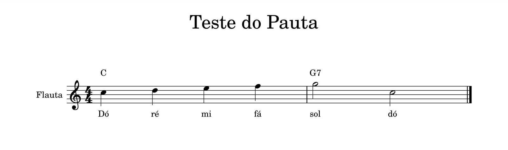

# Pauta

**Free music notation app for Mac.**

Free · No account · No ads · Nothing leaves your computer

[**⬇ Download for Mac**](https://github.com/movemontes/pauta/releases/latest/download/Pauta-mac.dmg) · [Website](https://movemontes.github.io/pauta/en/) · [Português](README.md)

## Why use it

- **Nothing leaves your Mac:** your scores stay on your computer.
- **No account, no login:** open it and write. No MuseHub, no e-mail.
- **Sound included:** plays right away, no gigabytes to download.
- **[Treco](https://github.com/movemontes/treco) family look:** cream paper, black outlines and an accent color you pick, plus a soft dark gray and a black background. The score itself keeps standard music engraving.
- **Colcheia, the mascot:** shows you around the first time and explains any button when you rest the mouse on it.
- **English and Portuguese:** follows your Mac's language, switch it in the **Pauta** menu.
- **Updates itself:** checks for a new version once a day.

## What it does

| Write | Listen | Arrange | Open and save |
|---|---|---|---|
| Notes by keyboard, mouse, on-screen piano or MIDI keyboard | Playback with a mixer | Parts for each instrument, linked to the score | MusicXML, MIDI, MuseScore (.mscz), Guitar Pro |
| Lyrics, chord symbols, chord diagrams | Reverb on/off in one click | Transposition | PDF, PNG, SVG |
| Tablature and drums | VST3 sound plugins | Unroll repeats | MP3, WAV, FLAC audio |
| Command palette (**Cmd+Shift+P**) | On-screen piano lights up while playing | Change key in one click | **Finale files (.musx, .mus)** |
| Full **Drums** palette | | Chord symbols from notes | PDF → editable score (with Audiveris) |
| Write like Finale (Speedy Entry) | | **Tabs**: many scores in one window | Export to another program |
| **Complete paste**: time signature, key, repeats and tempo come along | **Choose which voices play** | **Copy one part's layout to the others** | **Error-free MusicXML**: passes the official validation |
| **Backspace deletes backwards** while you write | | **Bigger repeat signs**: 3 sizes, with wings | **Picture capture** of the selection (300 dpi PNG) |
| **A new duration pushes the next notes** (optional) | **Play only the 1st or only the 2nd time** | **MIDI channels**: port and channel of each instrument | **MP4 video** of the score scrolling |
| | **Two sounds to choose from**: MS Basic or GeneralUser GS | | |

## How to install

1. [Download Pauta](https://github.com/movemontes/pauta/releases/latest/download/Pauta-mac.dmg) (`.dmg` file).
2. Open it and drag **Pauta** into **Applications**.
3. Open Pauta from Applications.
4. The first time, the Mac says it can't verify the app, because it is free and didn't go through Apple's store. Open **System Settings → Privacy & Security**, scroll down and click **Open Anyway**. You only do this once.

## Requirements and permissions

- Mac with an Apple chip (M1 or newer), macOS 13 or newer.
- **Documents folder:** the Mac asks the first time; Pauta keeps your scores in `Documents/Pauta`.
- Video export needs ffmpeg installed on the Mac (optional).

## Privacy

Pauta has no account, collects no data and never sends your scores anywhere. It only goes online once a day, to check for a new version.

## Thank you

Pauta is and will stay free. Thank you for using it! — Mateus

## For developers

How to build: `buildscripts/pauta/COMPILAR.md` (in Portuguese). The app is C++/Qt 6, made from MuseScore Studio 4.7.7.

## Origin and license

Pauta is free software **based on [MuseScore Studio](https://github.com/musescore/MuseScore)**, © 1999-2026 MuseScore Limited and others, so it is distributed under the **GNU General Public License version 3** (`LICENSE.txt`).
Pauta is not affiliated with or endorsed by MuseScore Limited or Muse Group. "MuseScore" is their trademark.
UI fonts: Archivo (SIL Open Font License). Sound: MS Basic (MIT license) and [GeneralUser GS](https://github.com/mrbumpy409/GeneralUser-GS) by S. Christian Collins (free to use and to ship with software). Finale files: [Denigma](https://github.com/rpatters1/denigma) (MIT license), shipped inside the app. Video: [FFmpeg](https://ffmpeg.org) 7.1.5 (LGPL 2.1), a small build shipped inside the app; source at [ffmpeg.org/releases](https://ffmpeg.org/releases/ffmpeg-7.1.5.tar.xz), build steps in `buildscripts/pauta/build_ffmpeg.sh`.
