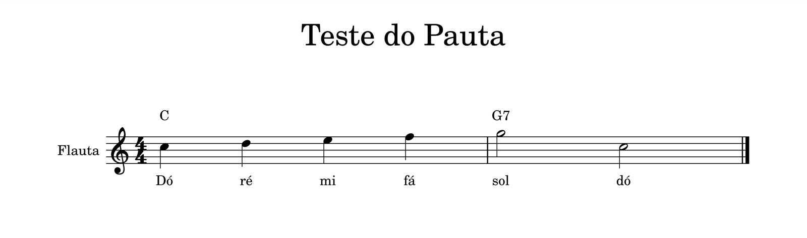

# Pauta

**Programa de partitura grátis para Mac.**

Grátis · Sem conta · Sem anúncio · Nada sai do seu computador

[**⬇ Baixar para Mac**](https://github.com/movemontes/pauta/releases/latest/download/Pauta-mac.dmg) · [Site](https://movemontes.github.io/pauta/) · [English](README.en.md)

## Por que usar

- **Nada sai do seu Mac:** suas partituras ficam no seu computador.
- **Sem conta e sem login:** abriu, escreveu. Sem MuseHub, sem e-mail.
- **Som que já vem junto:** toca na hora, sem baixar gigas de sons.
- **Visual da família [Treco](https://github.com/movemontes/treco):** papel creme, contorno preto e uma cor de destaque que você escolhe. Tem fundo cinza-escuro suave e fundo preto. A partitura continua com a gravura musical normal.
- **Colcheia, o mascote:** mostra o programa na primeira vez e explica cada botão quando você deixa o mouse parado em cima.
- **Português e inglês:** segue o idioma do Mac, com troca no menu **Pauta**.
- **Se atualiza sozinho:** procura versão nova uma vez por dia.

## O que ele faz

| Escrever | Ouvir | Organizar | Abrir e salvar |
|---|---|---|---|
| Notas pelo teclado, mouse, piano na tela ou teclado MIDI | Reprodução com mixer | Partes de cada instrumento, ligadas à grade | MusicXML, MIDI, MuseScore (.mscz), Guitar Pro |
| Letra, cifras, diagramas de acordes | Reverb liga/desliga com um clique | Transposição | PDF, PNG, SVG |
| Tablatura e bateria | Plugins de som VST3 | Desenrolar repetições | Áudio MP3, WAV, FLAC |
| Paleta de comandos (**Cmd+Shift+P**) | Piano na tela acende as notas tocando | Mudar tom com um botão | **Arquivos do Finale (.musx, .mus)** |
| Paleta **Bateria** completa | | Cifras a partir das notas | PDF → partitura editável (com o Audiveris) |
| Escrever como no Finale (Speedy Entry) | | **Abas**: várias partituras numa janela | Exportar para outro programa |

## Como instalar

1. [Baixe o Pauta](https://github.com/movemontes/pauta/releases/latest/download/Pauta-mac.dmg) (arquivo `.dmg`).
2. Abra o arquivo e arraste o **Pauta** para a pasta **Aplicativos**.
3. Abra o Pauta pelos Aplicativos.
4. Na primeira vez, o Mac avisa que não consegue verificar o app, porque ele é gratuito e não passou pela loja da Apple. Abra **Ajustes do Sistema → Privacidade e Segurança**, role até o fim e clique em **Abrir Mesmo Assim**. Só precisa fazer isso uma vez.

## Requisitos e permissões

- Mac com chip Apple (M1 ou mais novo), macOS 13 ou mais novo.
- **Pasta Documentos:** o Mac pede acesso na primeira vez; é lá que o Pauta guarda as partituras (`Documentos/Pauta`).
- Exportar vídeo precisa do ffmpeg instalado no Mac (opcional).

## Privacidade

O Pauta não tem conta, não coleta dados e não envia suas partituras para lugar nenhum. Ele só usa a internet uma vez por dia, para ver se saiu uma versão nova.

## Apoie

O Pauta é e vai continuar grátis. Se ele te ajudou, um Pix de qualquer valor ajuda muito:
**Pix (chave aleatória, PicPay):** `e2a1f4a9-ebfe-4c3c-a531-92a0e7433f14`. Obrigado de coração! — Mateus

## Para quem programa

Como compilar: `buildscripts/pauta/COMPILAR.md`. O app é C++/Qt 6, feito a partir do MuseScore Studio 4.7.7.

## Origem e licença

O Pauta é um programa livre **baseado no [MuseScore Studio](https://github.com/musescore/MuseScore)**, © 1999-2026 MuseScore Limited e colaboradores, e por isso é distribuído sob a **GNU General Public License versão 3** (`LICENSE.txt`), e não sob a MIT dos outros apps.
O Pauta não tem ligação com a MuseScore Limited nem com o Muse Group. "MuseScore" é marca deles.
Fontes da interface: Archivo (SIL Open Font License). Som: MS Basic (licença MIT). Arquivos do Finale: [Denigma](https://github.com/rpatters1/denigma) (licença MIT), que vai dentro do app.
